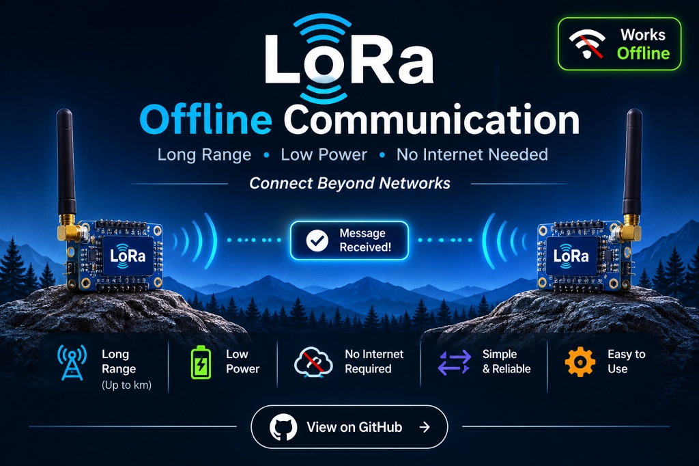

# MESH-X: Decentralized Off-Grid LoRa Mesh Messaging & Tactical Telemetry Ecosystem

<p align="center">
  
</p>

[](https://flutter.dev)
[](https://www.semtech.com/products/wireless-rf/lora-core/sx1278)
[](https://datatracker.ietf.org/doc/html/rfc8439)
[](https://datatracker.ietf.org/doc/html/rfc7748)
[]()
[](LICENSE)

**MESH-X** is an open-source, resilient, decentralized communication ecosystem designed to provide long-range, off-grid text and micro-image messaging during natural disasters, cellular infrastructure blackouts, tactical operations, or remote wilderness expeditions. 

The system operates **completely independent of internet backbones, cellular networks, SIM cards, or central servers**. A smartphone running the cross-platform Flutter application links to an ultra-low-power ESP32 hardware bridge via Bluetooth Low Energy (BLE), which transparently transmits multi-hop mesh packets across the 433 MHz ISM frequency band via a Semtech SX1278 LoRa transceiver.

---

## Table of Contents

1. [High-Level System Architecture](#1-high-level-system-architecture)
2. [Key Capabilities & Features](#2-key-capabilities--features)
3. [Complete Technology Stack](#3-complete-technology-stack)
4. [Hardware Requirements & Pinout Diagram](#4-hardware-requirements--pinout-diagram)
5. [End-to-End Encryption (E2EE) & Security Architecture](#5-end-to-end-encryption-e2ee--security-architecture)
6. [Communication Protocols & Packet Framing](#6-communication-protocols--packet-framing)
   - [Bluetooth Low Energy (BLE) Framing](#bluetooth-low-energy-ble-framing)
   - [LoRa Over-The-Air (OTA) Frame](#lora-over-the-air-ota-frame)
   - [Multi-Hop Mesh Routing & Deduplication](#multi-hop-mesh-routing--deduplication)
7. [LoRa Micro-Image Transmission System](#7-lora-micro-image-transmission-system)
8. [Tactical Polar Radar & Distance Estimation](#8-tactical-polar-radar--distance-estimation)
9. [Repository Structure](#9-repository-structure)
10. [Getting Started & Installation Guide](#10-getting-started--installation-guide)
11. [Testing & Verification](#11-testing--verification)

---

## 1. High-Level System Architecture

The architecture partitions responsibilities cleanly between the high-compute mobile device (UI, crypto, database, image compression) and the real-time embedded microcontroller (RF timing, SPI bus management, LoRa modulation, airtime scheduling).

```
+---------------------------------------------------------------------------------------+
|                                    MOBILE TIER                                        |
|                                                                                       |
|  +---------------------------------------------------------------------------------+  |
|  |                     Flutter Mobile Application (Android / iOS)                  |  |
|  |                                                                                 |  |
|  |  [Presentation Layer]              [Core / Security]      [Data / Storage]     |  |
|  |  • Chat & Bubble UI (Images/Text)  • X25519 ECDH Keys     • SQLite (Local DB)   |  |
|  |  • Tactical Radar & Map Display    • ChaCha20-Poly1305    • Reactive Streams    |  |
|  |  • Mesh Topology Visualizer        • Micro-JPEG (140x140) • Riverpod 2.x State  |  |
|  +---------------------------------------------------------------------------------+  |
+------------------------------------------+--------------------------------------------+
                                           |
                                           | BLE 4.2+ GATT Connection
                                           | Service: 0x0001 | MTU Negotiated Framing
                                           v
+---------------------------------------------------------------------------------------+
|                                HARDWARE GATEWAY TIER                                  |
|                                                                                       |
|  +---------------------------------------------------------------------------------+  |
|  |                        ESP32 DevKit V1 (Xtensa Dual-Core)                       |  |
|  |                                                                                 |  |
|  |  • BLE GATT Server (AA01-AA05)     • 64-Entry LRU Deduplication Ring Buffer     |  |
|  |  • Frame Packetizer & CRC-16       • Controlled Flooding Multi-Hop Mesh Router  |  |
|  |  • RadioLib v7.1.2 Driver Engine   • Dynamic Radio Register Tuning (SF/Freq/Pwr)|  |
|  +---------------------------------------------------------------------------------+  |
+------------------------------------------+--------------------------------------------+
                                           |
                                           | Hardware SPI Bus (GPIO 18, 19, 23, 5, 14, 26)
                                           v
+---------------------------------------------------------------------------------------+
|                                     RF PHY TIER                                       |
|                                                                                       |
|  +---------------------------------------------------------------------------------+  |
|  |                   Semtech SX1278 LoRa Transceiver (RA-02 Module)                |  |
|  |                                                                                 |  |
|  |  • Carrier Freq: 433.05 - 434.79 MHz   • Spreading Factor: SF7 - SF12           |  |
|  |  • Bandwidth: 125 kHz / 250 kHz        • Coding Rate: 4/7 (High FEC)            |  |
|  |  • TX Output: +14 to +20 dBm (PA_BOOST)• Sensitivity: Down to -128 dBm          |  |
|  +---------------------------------------------------------------------------------+  |
+------------------------------------------+--------------------------------------------+
                                           |
                                           | 433 MHz RF Airwaves (~1 - 10+ km LOS)
                                           v
                                [Surrounding Mesh Nodes]
```

---

## 2. Key Capabilities & Features

- **Zero-Cloud & Zero-Internet Operation**: Pure point-to-point and peer-to-peer communication. No accounts, SIMs, servers, or external DNS required.
- **True End-to-End Authenticated Encryption (E2EE)**: Messages and images are encrypted on the mobile device with **ChaCha20-Poly1305** using shared secrets derived via **X25519 Elliptic Curve Diffie-Hellman**. The ESP32 acts solely as an oblivious packet pipe and never possesses private keys.
- **Fast Contact Key Pairing (QR Scanner)**: Instant camera scanning (`mobile_scanner`) of `meshx://` URIs or 64-hex strings enables pairing cryptographic identities in under two seconds.
- **LoRa Micro-Image Transmission**: On-device micro-JPEG compression downsizing photos to 140x140 at 20% quality (~1.2–1.8 KB), split into 140-byte ASCII frames (`IMG:<ID>:<CHUNK>:<TOTAL>:<DATA>`), transmitted through LoRa without requiring firmware binary modifications.
- **Emergency SOS Distress Beacon**: One-touch broadcast beacon transmitting micro-degree ($E7$) GPS coordinates and distress messages. Displays a persistent situational banner across all nodes in the mesh.
- **Tactical Polar Radar & Signal Map**: Directional polar display calculating Great-Circle Haversine distance, forward bearing, and Log-Distance Path Loss RSSI proximity estimation.
- **Interactive Mesh Topology Graph**: Custom-rendered node visualization plotting active nodes, hop distances, and RF signal link qualities (RSSI/SNR).
- **Dynamic Radio Configuration**: In-app runtime tuning of Spreading Factor (SF7 to SF12), Channel Frequency (433.050 to 434.790 MHz), and Transmission Power (+14 dBm to +20 dBm) over BLE command frames.
- **Resilient Multi-Hop Flooding**: Decentralized routing with TTL (Time-To-Live) hop limits and a 64-entry LRU ring buffer that suppresses duplicate packets across relays.

---

## 3. Complete Technology Stack

| Layer | Technology | Purpose & Scope |
|---|---|---|
| **Mobile App (Frontend)** | **Flutter & Dart (3.11+)** | Cross-platform high-performance UI running on Android and iOS. |
| **State Management** | **Riverpod 2.x** | Reactive state container, dependency injection, and stream controllers. |
| **Local Database** | **SQLite (`sqflite`)** | Offline persistence for chats, conversations, delivered message receipts, and nodes. |
| **Cryptography** | **`cryptography` package** | Pure Dart implementation of X25519 (RFC 7748) and ChaCha20-Poly1305 AEAD (RFC 8439). |
| **Identity Scanning** | **`mobile_scanner` & `qr_flutter`** | Real-time camera QR reader and vector QR generation for public key interchange. |
| **BLE Communication** | **`flutter_blue_plus`** | Low-latency BLE central driver, MTU negotiation, and chunked frame handling. |
| **Image Processing** | **`image_picker`** | Native mobile camera and gallery picking with on-device downsampling and quality throttling. |
| **Microcontroller (MCU)** | **ESP32 DevKit V1** | Tensilica Xtensa Dual-Core 32-bit LX6 @ 240 MHz, 520 KB SRAM. |
| **Radio Transceiver** | **Semtech SX1278 (RA-02)** | Long-range 433 MHz Chirp Spread Spectrum (CSS) wireless transceiver. |
| **Embedded Firmware** | **C++ / Arduino ESP32 Core** | Interrupt-driven RF and BLE firmware engine. |
| **RF Driver Library** | **RadioLib (v7.1.2)** | Hardware register control, CAD (Channel Activity Detection), LNA gain, and preamble handling. |
| **Compliance & Math** | **Python 3.10+** | Semtech Time-on-Air (ToA) and 1% duty cycle legal compliance modeling tools. |

---

## 4. Hardware Requirements & Pinout Diagram

### Bill of Materials (Per Node)
1. **1× ESP32 DevKit V1** (30-pin or 36-pin variant).
2. **1× Semtech SX1278 LoRa Module (RA-02)**, 433 MHz band.
3. **1× Tuned 433 MHz Antenna** (Coil spring or SMA female dipole).
4. **1× 3.3V Power Source** (USB battery pack or 18650 Li-ion cell with TP4056 + 3.3V LDO regulator).
5. Quality jumper wires (keep lengths under 10 cm to ensure SPI signal integrity at 8 MHz).

### Hardware Wiring Schematic

```
       +------------------------------------+
       |          ESP32 DevKit V1           |
       |                                    |
       |            [3.3V OUT] -------------+---------> VCC (3.3V ONLY!)
       |                 [GND] -------------+---------> GND
       |        [GPIO 18/SCK]  -------------+---------> SCK
       |        [GPIO 19/MISO] <------------+---------- MISO
       |        [GPIO 23/MOSI] -------------+---------> MOSI
       |        [GPIO 5/NSS]   -------------+---------> NSS / CS
       |        [GPIO 14/RST]  -------------+---------> RESET
       |        [GPIO 26/DIO0] <------------+---------- DIO0
       |                                    |
       +------------------------------------+
                                                        |
                                                [RA-02 Module]
                                                        |
                                                  [ANTENNA (433MHz)]
```

### Complete Pin Mapping Table

| SX1278 RA-02 Pin | ESP32 Pin | Function / Description |
|---|---|---|
| **VCC** | **3V3** | **+3.3V DC (CRITICAL: Connecting to 5V will destroy the SX1278!)** |
| **GND** | **GND** | Common Ground Reference |
| **SCK** | **GPIO 18** | Hardware VSPI Serial Clock |
| **MISO** | **GPIO 19** | Hardware VSPI Master-In-Slave-Out |
| **MOSI** | **GPIO 23** | Hardware VSPI Master-Out-Slave-In |
| **NSS / CS** | **GPIO 5** | SPI Chip Select (Active Low) |
| **RESET** | **GPIO 14** | Hardware Radio Reset (Active Low) |
| **DIO0** | **GPIO 26** | Hardware RX/TX Done Interrupt Line |

> [!CAUTION]
> **RF Power Amplifier Safety Warning**: NEVER power the ESP32 while the SX1278 radio is initialized without an antenna connected. Transmitting into an open load causes severe impedance mismatch (infinite VSWR) that will permanently burn out the SX1278 power amplifier output stage.

---

## 5. End-to-End Encryption (E2EE) & Security Architecture

MESH-X enforces strict zero-trust payload privacy. Broadcasts (e.g. SOS or public mesh chatter) remain unencrypted for emergency discoverability, whereas all 1-to-1 direct node conversations are protected with authenticated cryptographic algorithms.

```
+---------------------------------------------------------------------------------------+
|                               CRYPTOGRAPHIC PIPELINE                                  |
|                                                                                       |
|  1. Identity Generation:                                                              |
|     Alice Phone                X25519 Keypair (Priv_A, Pub_A)                         |
|     Bob Phone                  X25519 Keypair (Priv_B, Pub_B)                         |
|                                                                                       |
|  2. Out-of-Band Pairing:                                                              |
|     Alice scans Bob's QR code  -> Reads Pub_B (32-byte Ed25519 curve25519 public key) |
|     (No public keys or private keys are ever transmitted over the open 433 MHz RF)    |
|                                                                                       |
|  3. Shared Secret Agreement:                                                          |
|     Shared Key (K) = X25519(Priv_A, Pub_B) == X25519(Priv_B, Pub_A)                  |
|                                                                                       |
|  4. Authenticated Payload Encryption (ChaCha20-Poly1305 AEAD):                        |
|     Plaintext Msg + 12-byte CSPRNG Nonce + Key (K)                                   |
|               |                                                                       |
|               v                                                                       |
|     Ciphertext (N bytes) + Poly1305 MAC Tag (16 bytes)                                |
|                                                                                       |
|  5. Oblivious LoRa Transmission:                                                      |
|     Wire Format: [12B Nonce][Ciphertext][16B MAC Tag]                                 |
|     (Nodes relay this payload over the mesh without being able to decrypt)           |
|                                                                                       |
|  6. Authenticated Decryption & Tamper Rejection:                                      |
|     Bob computes Poly1305 MAC over wire bytes.                                        |
|     • If MAC is valid   -> Plaintext decrypted and displayed.                         |
|     • If bit-flipped    -> Instantly rejected (Tampering Detected).                   |
+---------------------------------------------------------------------------------------+
```

### Key Security Properties
- **Authenticated Encryption with Associated Data (AEAD)**: ChaCha20 protects confidentiality; Poly1305 guarantees message integrity and authenticity.
- **Bit-Flip / Tampering Rejection**: Even a single corrupted or intercepted bit over the air causes the 16-byte Poly1305 MAC check to fail, preventing chosen-ciphertext attacks.
- **Zero-Trust Bridge**: The ESP32 firmware only receives already-encrypted binary blobs over BLE and passes them to the radio. An adversary with physical access to the ESP32 hardware cannot read past or present encrypted communications.

---

## 6. Communication Protocols & Packet Framing

### Bluetooth Low Energy (BLE) Framing

The ESP32 runs a custom GATT server with 128-bit base UUID: `4D455348-5800-xxxx-8000-00805F9B34FB` (ASCII `MESH-X`).

| Characteristic | UUID | Properties | Description |
|---|---|---|---|
| **Primary Service** | `0x0001` | — | Main MESH-X Service identifier |
| **Device Info** | `0x0002` | `Read` | Node ID, hardware model, firmware & protocol version |
| **Command In** | `0x0003` | `Write` / `WriteNoResp` | Binary command stream from Mobile App to ESP32 |
| **Event Out** | `0x0004` | `Notify` | Inbound RF events and received packets to Mobile App |
| **Telemetry** | `0x0005` | `Read`, `Notify` | Real-time RSSI, SNR, battery voltage, and queue health |

#### Binary Frame Structure (BLE Transport)
```
 0                   1                   2                   3
 0 1 2 3 4 5 6 7 8 9 0 1 2 3 4 5 6 7 8 9 0 1 2 3 4 5 6 7 8 9 0 1
+-+-+-+-+-+-+-+-+-+-+-+-+-+-+-+-+-+-+-+-+-+-+-+-+-+-+-+-+-+-+-+-+
|       MAGIC (0xAA, 0x58)      |    VER (0x01) |   FRAME_TYPE  |
+-+-+-+-+-+-+-+-+-+-+-+-+-+-+-+-+-+-+-+-+-+-+-+-+-+-+-+-+-+-+-+-+
|          SEQ_NUM (16)         |       TOTAL_PAYLOAD_LEN (16)  |
+-+-+-+-+-+-+-+-+-+-+-+-+-+-+-+-+-+-+-+-+-+-+-+-+-+-+-+-+-+-+-+-+
|         FRAG_INDEX (8)        |       FRAG_COUNT (8)          |
+-+-+-+-+-+-+-+-+-+-+-+-+-+-+-+-+-+-+-+-+-+-+-+-+-+-+-+-+-+-+-+-+
|                  VARIABLE PAYLOAD (0..N bytes)                |
+-+-+-+-+-+-+-+-+-+-+-+-+-+-+-+-+-+-+-+-+-+-+-+-+-+-+-+-+-+-+-+-+
|                     CRC16-CCITT (16-bit)                      |
+-+-+-+-+-+-+-+-+-+-+-+-+-+-+-+-+-+-+-+-+-+-+-+-+-+-+-+-+-+-+-+-+
```

---

### LoRa Over-The-Air (OTA) Frame

All transmissions over 433 MHz use a compact 16-byte fixed binary header to minimize radio time-on-air (ToA) and respect regional duty cycles.

```
 0                   1                   2                   3
 0 1 2 3 4 5 6 7 8 9 0 1 2 3 4 5 6 7 8 9 0 1 2 3 4 5 6 7 8 9 0 1
+-+-+-+-+-+-+-+-+-+-+-+-+-+-+-+-+-+-+-+-+-+-+-+-+-+-+-+-+-+-+-+-+
|  MAGIC (0x58) |  VER (0x01)   |  PACKET_TYPE  |     FLAGS     |
+-+-+-+-+-+-+-+-+-+-+-+-+-+-+-+-+-+-+-+-+-+-+-+-+-+-+-+-+-+-+-+-+
|    TTL (8)    |   HOP_COUNT   |         RESERVED (16)         |
+-+-+-+-+-+-+-+-+-+-+-+-+-+-+-+-+-+-+-+-+-+-+-+-+-+-+-+-+-+-+-+-+
|                      PACKET_ID (32-bit uint)                  |
+-+-+-+-+-+-+-+-+-+-+-+-+-+-+-+-+-+-+-+-+-+-+-+-+-+-+-+-+-+-+-+-+
|                    SOURCE_NODE_ID (32-bit)                    |
+-+-+-+-+-+-+-+-+-+-+-+-+-+-+-+-+-+-+-+-+-+-+-+-+-+-+-+-+-+-+-+-+
|                  DESTINATION_NODE_ID (32-bit)                 |
+-+-+-+-+-+-+-+-+-+-+-+-+-+-+-+-+-+-+-+-+-+-+-+-+-+-+-+-+-+-+-+-+
| PAYLOAD_LEN(8)|      PAYLOAD / CIPHERTEXT (0..235 bytes)      |
+-+-+-+-+-+-+-+-+-+-+-+-+-+-+-+-+-+-+-+-+-+-+-+-+-+-+-+-+-+-+-+-+
|                     CRC16 / AUTH CHECKSUM                     |
+-+-+-+-+-+-+-+-+-+-+-+-+-+-+-+-+-+-+-+-+-+-+-+-+-+-+-+-+-+-+-+-+
```

- `FLAGS` Bitmask:
  - `0x01`: Direct Message
  - `0x02`: Emergency SOS Broadcast
  - `0x04`: Public Mesh Broadcast
  - `0x08`: End-to-End Encrypted Payload

---

### Multi-Hop Mesh Routing & Deduplication

MESH-X utilizes an energy-efficient **Controlled Flooding** protocol:

1. **Broadcast Scope**: Packets addressed to `0xFFFFFFFF` are marked with `FLAG_BROADCAST (0x04)`. Every receiving node passes them to its local user interface and re-transmits them if $TTL > 1$.
2. **Direct Addressing**: Packets addressed to a specific 32-bit Node ID are only committed to the chat database on the matching recipient node. Sibling nodes quietly relay the packet if $TTL > 1$ without showing false conversations.
3. **Loop Suppression (LRU Buffer)**: Each node maintains a fast 64-entry ring buffer of `(packet_id, source_node_id)` pairs. If an identical packet is received again (e.g. via an alternate relay path), it is immediately dropped in under 5 microseconds.
4. **Hop Limiting**: Every relay decrements `TTL` by 1 and increments `HOP_COUNT` by 1. When `TTL == 0`, the packet is dropped, preventing infinite RF broadcast storms.

---

## 7. LoRa Micro-Image Transmission System

While LoRa is traditionally restricted to short sensor telemetry or plain text due to its low data rate (~3–5 kbps), MESH-X incorporates a custom multi-frame streaming image pipeline:

```
[Mobile Camera / Gallery]
           |
           v
[On-Device Downscaler] --------> Resizes to 140x140 resolution, 20% JPEG quality (~1.2 - 1.8 KB)
           |
           v
[Base64 Stream Encoder] -------> Produces ~1,600 - 2,400 ASCII characters
           |
           v
[Chunk Fragmenter] ------------> Slices into 140-char frames:
                                 "IMG:<IMG_ID>:<CHUNK_IDX>:<TOTAL_CHUNKS>:<DATA_SLICE>"
           |
           v
[Transparent LoRa Relay] ------> Transmitted over 433 MHz RF as standard transparent packets
           |
           v
[Receiver App Buffer] ---------> Reassembles out-of-order chunks in memory
           |
           v
[Decoded SQLite Cache] --------> Stored as [IMAGE:$base64], rendered in chat bubble with full-screen zoom
```

- **Zero Firmware Alterations Required**: The ESP32 and SX1278 treat image frames as regular text packets (~160–175 bytes each), completely bypassing firmware buffer allocation limits.
- **Paced Transmission**: Slices are transmitted with deliberate 180 ms spacing to allow channel clearance and prevent RF collision.

---

## 8. Tactical Polar Radar & Distance Estimation

MESH-X includes an integrated situational awareness radar on the mobile client:

- **Mathematical Distance & Bearing**: Calculates true Great-Circle distance using the **Haversine formula** and forward azimuth bearing ($\theta$) from the mobile device's GPS to emergency distress beacons:
  
  $$\Delta\sigma = 2 \arcsin \left( \sqrt{\sin^2\left(\frac{\Delta\phi}{2}\right) + \cos(\phi_1)\cos(\phi_2)\sin^2\left(\frac{\Delta\lambda}{2}\right)} \right)$$

- **Log-Distance Path Loss Model**: When GPS coordinates are unavailable, the system estimates approximate distance from radio frequency physical attenuation:
  
  $$d = 10^{\frac{P_{\text{tx}} - \text{RSSI}}{10 \cdot n}}$$
  
  *(where $n = 2.7$ for suburban / open foliage clutter).*

- **Visual Polar Radar**: Plots peer nodes and active SOS distress signals in real-time on a concentric polar radar sweep with interactive bearing headings.

---

## 9. Repository Structure

```
MESH-X/
├── mesh_x_app/                        # Flutter Mobile Application
│   ├── lib/
│   │   ├── core/                      # Constants, theme, security, CRC16, geo utils
│   │   │   ├── constants/ble_constants.dart
│   │   │   ├── security/crypto_service.dart
│   │   │   └── utils/geo_utils.dart
│   │   ├── features/
│   │   │   ├── chat/                  # Messaging, image chunking, chat UI
│   │   │   │   ├── data/chat_repository.dart
│   │   │   │   └── presentation/chat_conversation_screen.dart
│   │   │   ├── device/                # BLE controller, radio config tuning
│   │   │   ├── mesh/                  # Topology graph, node explorer, key exchange
│   │   │   │   └── presentation/mesh_topology_graph.dart
│   │   │   └── sos/                   # Emergency distress beacon, tactical radar
│   │   │       └── presentation/tactical_radar_map.dart
│   │   └── main.dart
│   └── test/                          # Comprehensive unit & widget test suite
│       ├── unit_test.dart
│       └── widget_test.dart
│
├── mesh_x_firmware/                   # Embedded ESP32 & SX1278 Firmware
│   ├── src/
│   │   ├── main.ino                   # Main loop, interrupt handling, BLE & LoRa routing
│   │   ├── mesh_x_config.h            # Frequency, pinout, and buffer sizing definitions
│   │   └── ble_protocol.h             # BLE GATT framing and command definitions
│   └── platformio.ini                 # PlatformIO build configuration
│
├── tools/                             # Engineering & Compliance Tools
│   └── airtime_calculator.py          # Semtech ToA & 1% duty cycle audit script
│
├── docs/                              # Technical Engineering Specifications
│   ├── assets/
│   │   └── mesh_x_banner.jpg          # Repository header graphic
│   ├── SYSTEM_ARCHITECTURE.md
│   ├── BLE_PROTOCOL.md
│   ├── RADIO_PROTOCOL.md
│   ├── SECURITY_MODEL.md
│   ├── HARDWARE_WIRING.md
│   ├── FIELD_TEST_GUIDE.md
│   └── AIRTIME_AUDIT.md
│
├── CHANGELOG.md                       # Release notes and version history
└── README.md                          # Main project documentation (This file)
```

---

## 10. Getting Started & Installation Guide

### Prerequisites
- **Flutter SDK**: `v3.41.0` or higher (`Dart 3.11+`)
- **Android Studio / Xcode**: For mobile compilation
- **Arduino IDE** or **PlatformIO**: For ESP32 firmware compilation
- **Python**: `3.10+` (optional, for airtime simulation tools)

---

### Step 1: Flashing the ESP32 Hardware Node

#### Option A: Using PlatformIO (Recommended)
```bash
cd mesh_x_firmware
pio run --target upload
```

#### Option B: Using Arduino IDE
1. Install **ESP32 Board Support**: Open *Preferences* -> *Additional Board Manager URLs* and add:
   `https://raw.githubusercontent.com/espressif/arduino-esp32/gh-pages/package_esp32_index.json`
2. Install **RadioLib**: Open *Library Manager* -> Search and install **`RadioLib` by Jan Gromes** (`v7.1.2`).
3. Open `mesh_x_firmware/src/main.ino`.
4. Select Board: **ESP32 Dev Module**.
5. Connect your ESP32 via USB and click **Upload**.
6. Open Serial Monitor at **115200 baud** to confirm initialization:
   ```text
   [INIT] MESH-X Node Starting...
   [INIT] Node ID: 0xA1B2C3D4
   [LORA] SX1278 Initialized: 433.175 MHz | SF9 | BW 125 kHz
   [BLE] Advertising Service: MESH-X-B2C3D4
   ```

---

### Step 2: Running the Flutter Mobile Application

1. Connect your Android or iOS device via USB (or start an emulator).
2. Navigate to the mobile app directory:
   ```bash
   cd mesh_x_app
   flutter pub get
   ```
3. Run on your physical device:
   ```bash
   flutter run
   ```
4. In the app:
   - Navigate to the **Radar / Device** tab and tap **Scan for Nodes**.
   - Connect to your discovered hardware node (e.g. `MESH-X-B2C3D4`).
   - Open the **Messages** tab to transmit public broadcast messages, or scan a peer's QR code to initiate end-to-end encrypted direct messaging!

---

## 11. Testing & Verification

The codebase includes an extensive suite of automated unit tests covering cryptographic round-trips, binary wire protocols, CRC-16 computation, radio airtime estimation, image fragmentation, and UI navigation:

```bash
cd mesh_x_app
flutter analyze
flutter test
```

### Verified Test Matrix (26/26 Tests Passing)
- **CRC-16-CCITT Determinism**: Validates polynomial `0x1021` checksum calculations.
- **X25519 & ChaCha20-Poly1305 Round-Trip**: Verifies keypair generation, authenticated encryption, and tamper detection via Poly1305 authentication failure.
- **Mesh Router Deduplication**: Validates 64-entry LRU ring buffer duplicate rejection.
- **Multi-Hop TTL Rules**: Tests TTL decrement and hop count increment logic.
- **LoRa Micro-Image Slicing**: Validates chunking, out-of-order packet reassembly, and byte-level reconstruction.
- **GeoUtils & Haversine Distance**: Tests coordinate distance and directional bearing algorithms.
- **RadioConfig Tuning**: Verifies binary encoding and decoding of runtime frequency, SF, and power configurations.

---

## License

This project is licensed under the **MIT License** - see the [LICENSE](LICENSE) file for details. Built for off-grid resilience, humanitarian assistance, and tactical communication.
